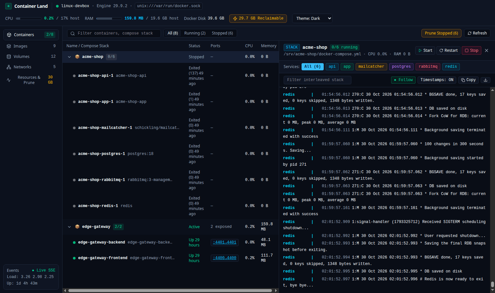
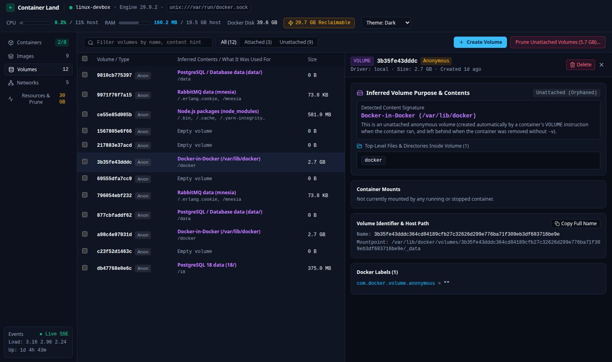
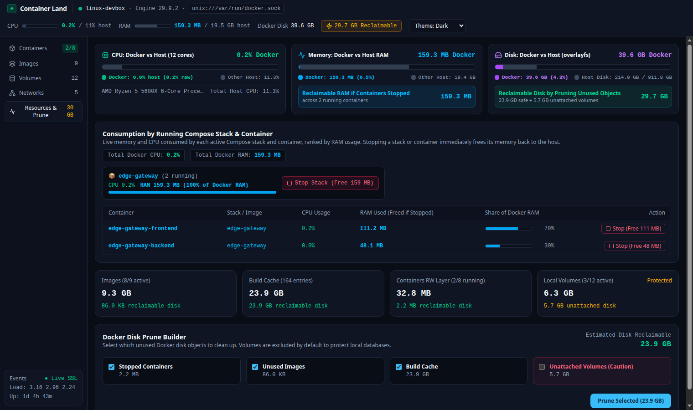

After moving almost all of my day-to-day work over to Linux, I needed a quick way to visualise what was running, what wasn't, and what was sitting in my images and volumes (since I now use local containers for almost all my development). With where AI models are at now (Opus 5.5, Argon, GPT Sol, and so on), personal software is becoming more practical than ever, so I built a UI-based dashboard over the open-source Docker Engine to make day-to-day container work more user-friendly. Introducing [Container Land](https://github.com/CodeBrewStudio/container-land), a lightweight local Docker dashboard under the MIT licence.

Running Docker natively on Linux gives you containers straight on the kernel with zero virtual machine overhead, which is great until you miss the visual side of Docker Desktop. Tailing interleaved logs across a six-service Compose stack, jumping into a container shell, or figuring out why `/var/lib/docker` ate 40 GB of disk gets tedious in the terminal alone. Most visual tools either bring back a heavy VM or ask you to run another containerised web app with its own database just to inspect the containers you already have.

## What it does

Container Land is a single binary. It talks straight to your local Docker socket and serves a web UI on `http://127.0.0.1:8485`.

The main view groups containers by Compose stack instead of dumping everything into one flat list. Click a stack and you get colour-coded, interleaved logs across every service at once, complete with service filters, live search, and one-click copy. There's also an in-browser terminal (`xterm.js`) wired straight into `exec`.

Anonymous Docker volumes used to drive me mad. You're left staring at unattached folders named with 64-character hashes, guessing whether one holds a local Postgres database or 2 GB of old `node_modules`. Container Land runs a fast, read-only check on unattached volumes and labels what's inside (PostgreSQL, RabbitMQ, Node packages, Docker-in-Docker, or empty), with a drawer showing top-level files before anything gets deleted.

The Resources & Prune view splits Docker's CPU, RAM, and disk usage from the rest of the host. Active Compose stacks are ranked by memory footprint, with one-click stop buttons showing how much RAM you'll reclaim. Local volumes are excluded from disk pruning by default behind an explicit opt-in, so routine cleanup won't wipe out a database by mistake.

## A few engineering choices behind it

Under the hood, the backend is a Go daemon built purely on the Go standard library. No official Docker SDK, and none of its hundred-plus transitive dependencies. It talks directly over the Unix socket, whilst the React and TypeScript UI compiles straight into the binary. At idle it sits around 2 MB of RAM.

GitHub Actions publishes static binaries for Linux (`amd64` and `arm64`), Windows via WSL2, and macOS (with automatic socket discovery for OrbStack, Colima, Rancher Desktop, and Docker Desktop). Passing `--install-service` sets up a user-level `systemd` unit on Linux or a `LaunchAgent` on macOS. No root or `sudo` needed.

Using your own tool every day catches bugs clean test fixtures miss. During a recent security and performance pass (locking down localhost same-origin and WebSocket checks and expanding frontend test coverage), testing against my own machine hit 26,915 local Docker volumes. The Volumes view froze on the spot and triggered a live event feedback loop. Adding pagination, capping probe batches, and filtering mount events in the stream sorted it out.

## Where to find it

Pre-built binaries, setup notes, and the full source are on [GitHub](https://github.com/CodeBrewStudio/container-land). Issues and PRs are always welcome.

Tools like this reflect how I like to work at [Code Brew Studio](/#contact): building small, practical software around real engineering friction rather than putting up with clunky defaults.
