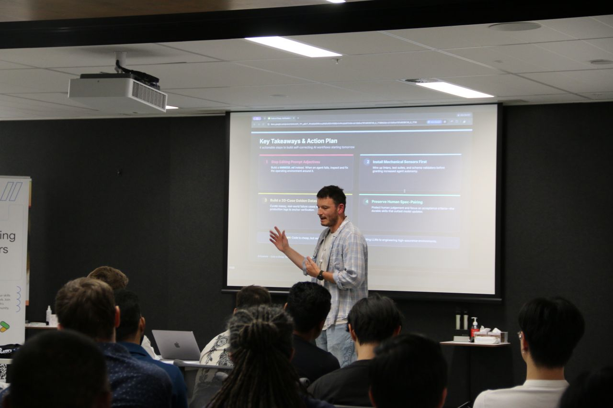

At DevFest Perth 2026, I wanted to talk about how I've been working on harnesses around AI models to produce reliable, verfiable work in a self improving loop to accelerate delivery of work with fewer errors. Agentic coding systems are able to deliver code at incredible speeds now, but verification and quality assurance has not kept pace. And tried-and-true practices of testing, and automated checks are now more important than ever before.

The first thing I asked the room was if anyone knew what a harness was in the context of AI. Unsurprisingly, I only got a couple of hands. Then I asked who's been using Opus, Fable, GPT or Gemini models to help them write code. Then I asked who's been using Claude Code, Antigravity, Cursor or Codex. I then highlighted to the group, that they've already been using a harness without knowing it! Claude Code or Antigravity are harnesses that are produced by the frontier labs that publish models, on those models.

For the last couple of years, whenever an AI coding agent broke something, the knee-jerk fix was to fiddle with the prompt. Add sterner adjectives, or swap in whatever frontier model shipped on Tuesday. But teams moving agents out of chat windows and into real repos keep hitting the same wall. Code is cheap now. An agent can spit out a thousand lines of Python or Rust in thirty seconds, but checking if it's actually working in the way you expect still takes most of the afternoon.

## The model matters less than the system around it

In the talk I called this the "two clocks" problem. Clock one, generating code, has dropped to seconds. Clock two, verifying and deciding whether to ship it, is still stuck at hours or days. Replying in a chat with "are you sure this is right?" doesn't help. You just end up in a circular hallucination loop where the model grades its own guess and agrees with itself.

The hardware metaphor helps: the LLM is a raw CPU, and everything wrapped around it is the operating system. Left alone, a model with frozen weights can only predict tokens. It can't run tests, read live logs, or stop itself repeating a mistake ten minutes later. That surrounding layer (instructions, permissions, shared memory, scripts, hooks, retry caps) is the **harness**. Good news if you don't have an ML PhD: harness engineering is just old-fashioned software engineering habits.

I learnt this the hard way auditing 208 sessions across two production codebases: RocketFlag (my Go and React feature-flag SaaS) and a client's multi-tenant clinical Rails app. A Python script compressed 111 MB of transcripts down to 440 KB of friction signals. The annoying bit was that almost every rule the agents broke was already sitting in `AGENTS.md` or a memory file. I even found 29 memory files buried in Claude's private `.claude/` folder (13 not indexed), invisible the moment I switched to Antigravity, which then repeated mistakes Claude had already solved.

Prose drifts once context compacts. Moving key rules into actual harness mechanics (verification gates, scripted PR close-outs, shared memory across tools) cut average human follow-up turns from 8.4 to 4.6, and PR close-out turns from 7.1 to 3.8. Same frozen models. Better operating system.

## The seven dimensions of trust

Stop judging an agent setup by one accuracy number, or one lucky demo. If you want agents shipping code you're willing to carry the pager for, measure the harness across seven dimensions.

**1. Outcome correctness.** Check the actual state of the system, not a cheerful paragraph claiming it worked. Across fifteen-plus sessions on that Rails app, agents ran unit tests, saw green, and called the feature done while the UI was broken. Our fix was a handback gate forcing the agent to tag every claim as static (read-only) or UI-verified (booted in my signed-in Chrome browser, clicked through, screenshot attached). Once an agent has to type "static" next to a frontend fix, it catches itself and tests the app.

**2. Process quality.** Getting the right answer isn't enough if the agent burns half your morning getting there. One client session blew out to 108 turns because the agent kept scattering debug print lines across the repo instead of reading the live server logs right in front of it. Watching step inflation and redundant tool calls points straight to the missing guardrail.

**3. Efficiency.** Raw token spend per prompt hides the real bill. Track success-adjusted cost (`C_succ`), the total token and human cost per finished, merged change. A pricier model with a branch-check script and repeatable close-out skill is cheaper (in API bills and in your afternoon) than a bargain run that fails three times and leaves you playing janitor.

**4. Reliability.** Single-run luck will fool you. Measure `pass^k`, the odds that *all* `k` runs succeed in a row. Say an agent lands a PR cleanly 80% of the time (looks tidy on a slide). Run it five times and your odds drop to around 33% (`0.8^5`). Pulling our rebase, CI-polling, and review-bot loop out of freeform chat into a scripted skill is how we pushed `pass^k` out of demo territory.

**5. Robustness.** Nobody writes museum-grade prompts at 4:30 pm on a Thursday. Paste three messy lines from Slack and ask "is this worth fixing?", and an unguarded agent treats your question as an order and edits files. A solid harness absorbs sloppy input: ours routes bug reports to a diagnose-only path and blocks edits at a pre-tool hook until I say go, no matter how half-arsed my phrasing was.

**6. Safety.** Don't trust polite prose to stop destructive commands. After compaction, text rules vanish (agents kept spawning an unauthenticated built-in browser on me for ten-plus sessions, even with the rule sitting in our docs). Dual-encoding fixes it: explain the rule in text so the model knows *why*, then enforce it mechanically in permissions or the sandbox. Block `rm -rf`, block `DROP TABLE`, and disable tools the agent shouldn't touch.

**7. Fairness.** In engineering, fairness means spotting subgroup disparity across your workload. Your setup might fly through small TypeScript UI tickets while falling over on multi-tenant Rails queries or legacy migrations (usually because one repo has strict linters and characterisation tests while the other runs on vibes). Slicing metrics by repo and task type stops easy wins from hiding where things are brittle.

## Where to start

What triggered this work was the open source repository that popped up from Google on Github a month or so ago: [https://github.com/google-research/harness2](https://github.com/google-research/harness2). I was reading the repo and some of the media and research articles around it which piqued my interest, as I was feeling this pain myself in my day to day. And whilst I had made skills and so forth to automate some longer pieces, the harness takes it to a whole new level.

If you want to try this tomorrow, wire up mechanical sensors first (linters, typecheckers, fast tests, schema checks, hard permission gates) and collect twenty messy failures from your own logs as a golden dataset. Keep humans owning specs and acceptance criteria too. If junior devs only clean up AI slop all day, they never build the judgement that turns them into seniors.

The slides and speaker notes are up [here](https://docs.google.com/presentation/d/e/2PACX-1vQeq450yx8odJVZcbXmFpLbROMT9bHzHkfIL8cSc0KCTLdwH9fdE2dAD_CAsijBwnpz9qOgjlsFBk-t/pub) if you want to poke through the diagrams and numbers. If your team is trying to get AI coding agents working reliably in production, I help teams set this stuff up through [Code Brew Studio](/#contact).
