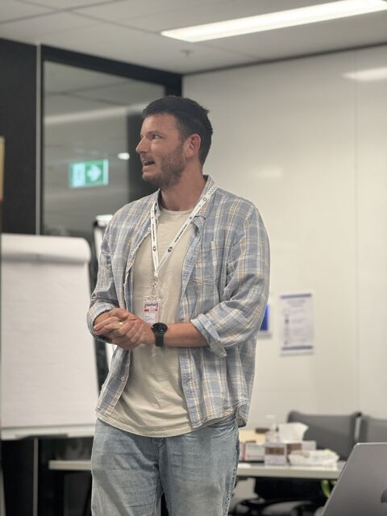

At DevFest Perth 2026, I talked about building harnesses around AI models to produce reliable, verifiable work in a self-improving loop. An agent can spit out a thousand lines of Python or Rust in thirty seconds now, but checking if it actually works still takes most of the afternoon.

I started by asking the room who knew what an AI harness was. Unsurprisingly, only a couple of hands went up. Next I asked who'd been using Opus, Fable, GPT or Gemini to write code, then who'd been using Claude Code, Antigravity, Cursor or Codex. Most of the room was already using a harness without knowing it! Tools like Claude Code and Antigravity are harnesses built by the frontier labs around their models.

## The model matters less than the system around it

In the talk I called this the "two clocks" problem: generating code takes seconds, whilst verifying it still takes hours or days. Replying in chat with "are you sure this is right?" doesn't help, because the model just grades its own guess. A handy way to frame it is hardware: the LLM is a raw CPU and the **harness** is its operating system (instructions, permissions, memory, scripts, hooks, retry caps). Building one comes down to normal software engineering habits, no ML PhD required.

I learnt this auditing 208 sessions across RocketFlag (my Go and React SaaS) and a client's clinical Rails app. Compressing 111 MB of session transcripts showed almost every broken rule was already written down in `AGENTS.md` or memory files, including 29 trapped inside one tool's folder and invisible once I switched to Antigravity. Moving rules out of written instructions and into real harness mechanics (with the exact same models underneath) cut average human back-and-forth from 8.4 turns to 4.6, and pull-request close-outs from 7.1 to 3.8.

## The seven dimensions of trust

A single accuracy number doesn't say much about production readiness. In the talk I walked through seven dimensions for evaluating a harness:

**1. Outcome correctness.** Passing unit tests doesn't mean the app works. After 15-plus Rails sessions where tests went green while the UI was broken, we added a handback gate requiring proof in a signed-in Chrome browser (with a screenshot) before closing frontend work.

**2. Process quality.** The path to a fix matters too. One session took 108 turns scattering debug prints instead of checking live server logs, flagging a missing guardrail.

**3. Efficiency.** Raw token spend misses the cost of rework, so cost per finished, merged change is a better guide. A pricier model backed by automated branch checks and a repeatable release script costs less than a cheaper one that fails three times.

**4. Reliability.** Single runs can be luck, so multi-run consistency matters more. An 80% success rate drops to around 33% across five runs in a row, which is why we scripted our git, CI, and review-bot checks instead of leaving them to chance.

**5. Robustness.** Day-to-day prompts are often vague. When I paste a rough Slack bug note asking "is this worth fixing?", our harness routes it to diagnosis only and blocks code edits automatically until I say go.

**6. Safety.** Written rules fade once context gets compressed in long sessions (agents broke our browser rule across 10-plus sessions). Dual-encoding pairs a text rule with hard permission blocks on destructive commands like `rm -rf`, `DROP TABLE`, or unwanted tools.

**7. Fairness.** Average pass rates hide gaps across codebases. A harness can handle small TypeScript UI changes reliably while struggling on multi-tenant Rails queries or legacy migrations where linters and baseline tests are thinner.

## Where to start

This work started after Google put [google-research/harness2](https://github.com/google-research/harness2) up on GitHub a month or so ago. Reading it and the research around it hit close to home in my day to day. Whilst I'd already built skills and so forth for longer tasks, thinking about the whole harness took it much further.

A good starting point is wiring up automated checks first (linters, tests, schema checks, permission gates) and pulling twenty real failures from your logs into a test suite, while keeping humans on specs and acceptance criteria so junior devs still build judgement.

The slides and speaker notes are [here](https://docs.google.com/presentation/d/e/2PACX-1vQeq450yx8odJVZcbXmFpLbROMT9bHzHkfIL8cSc0KCTLdwH9fdE2dAD_CAsijBwnpz9qOgjlsFBk-t/pub). If your team wants AI coding agents working reliably in production, I help teams set this up through [Code Brew Studio](/#contact).
